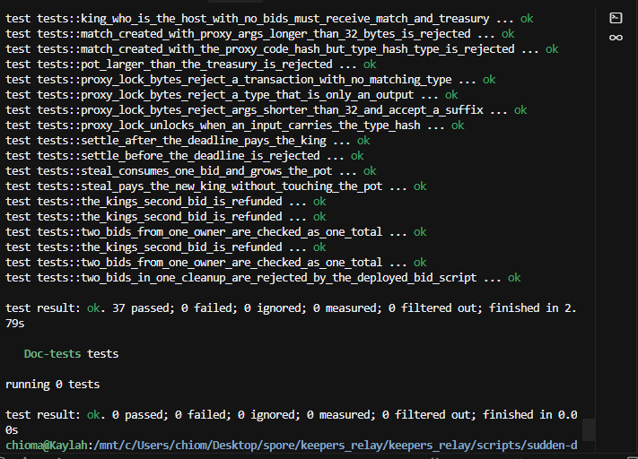

# Week 22

- Name: Chioma Christopher
- Week ending: 10-17-2026
- Project: Crowns
- Continues: [Week 21](../week_21/week_21.md)

---

## What happened

Last week the game became sudden death. One match, one clock, one pot, one king. The scripts typechecked, five tests passed, and play could build a proof on one machine.

This week I put it on testnet and made it something you can actually do with friends.

The app is called Crowns now. You connect once, claim a username, then you can host or play. From the players list you can challenge someone. That opens a crown with their name on it. Or you host one yourself and send the link. The lobby already holds more than two people. Everyone sits in the same room, on the same clock.

I first wrote this week as if the fix was to add spare minutes so JoyID would not eat a tiny window. That was the wrong kind of time. The fun is not a longer clock. The fun is a clock that shrinks.

## How a crown works

The host writes four-option lines. A quiz, a lyric blank, a place. Players do not write the lines. They pick one.

Opening the lobby does not touch CKB yet. It saves the room, the questions, and the salts. Friends join the link and you can see who is in. Start the clock is the transaction. That is the moment the Merkle root goes into the match cell. The question text never goes on chain.

Each player signs once, to lock a bid. The bid has to point at the live match cell, so you cannot lock before the host has started. After that, answering does not ask for another signature.

A right answer spends that one bid into the pot and names you king. The pot grows by the entry. The clock shrinks. The first steal cuts 10 minutes. After that the cut halves every two rounds, and it never goes under 72 seconds. If the time left is already smaller than the cut, the deadline becomes one second. It does not become zero.

A wrong answer is that player's only try on that question. The bid stays. The pot does not move. Nothing about a miss is written on chain.

One match cell means one confirmed steal in a block. If four friends get it right together, one of them takes the crown. The others keep their bids. While you are king you do not lock again. If someone takes it from you, you lock again to come back.

The bar hitting zero does not end the question. It is just the earliest moment the host may close. A correct steal still counts until that close lands. The chain clock is `since`. It can say "not before." It cannot say "not after." The median time on CKB lags the clock on the wall, so the close waits for the chain.

On the close, the king is paid the pot. The host gets what is left of the match and the treasury. If the king is the host, that one lock gets the match and the treasury together. That check only runs on the close, not on a steal.

Later I want the questions to be random, even ones the host has not seen, generated ahead of the room. The chain does not need to change for that. It only stores the root. Friends would still sit in this same lobby and race this same shrinking clock.

## The root

It is a real Merkle root. Not a label.

The bank has to be 2, 4, 8, 16, 32, or 64 questions. Each leaf is a CKB hash of the match id, the question index, the hash of the question text, the correct option, how many options there are, and a salt. Each parent hashes the two children under it. The match script walks the sibling path and only accepts the steal when it rebuilds the same root that was written at the start.

The hash is blake2b-256 with the personalization `ckb-default-hash`. That is the CKB hash, not Bitcoin's double SHA-256.

A server can refuse to hand you a proof. It cannot invent a proof for a wrong option.

## The scripts

There are three scripts I wrote, plus our own copy of the proxy lock.

- The match script is the crown. It keeps the root, the fee, the pot, the deadline, and the king. A steal must grow the pot and shrink the deadline. It must not pay the pot out.
- The bid script is the entry. The args are the match type hash, then the owner's lock hash. Creating one requires the live match cell as a dependency.
- The treasury script is the pot. Capacity in that cell is the prize.
- The proxy lock is the public Input Type Proxy Lock. I copied the bytes and deployed my own cell. The next section is the trail.

I upgraded the match script in place, so its type id stayed the same. The treasury already had the rule that pays the host and the king together when they are the same lock, so I left that binary alone. The bid binary stayed too.

## The proxy I copied

I copied the Input Type Proxy Lock from [ckb-proxy-locks](https://github.com/ckb-devrel/ckb-proxy-locks). Nervos documents it here: [Input Type Proxy Lock](https://docs.nervos.org/docs/ecosystem-scripts/input-type-proxy-lock).

The published rule is small. The args are 32 bytes, and those bytes are a type-script hash. The lock unlocks when any input in the transaction carries that type. It does not ask for a signature.

That is the hole a steal needs. The host signs once to create the match. Each player signs once to lock a bid. After that, a steal and a close have to spend the match cell and the bid without asking either of them again. I put this lock on both cells. The args are the match type hash. The cells can move only while the match script is an input and is checking the proof, the pot, and the clock.

The published binary is the same on mainnet and testnet. Hash type is `data1`. The code hash of those bytes is:

`0x5123908965c711b0ffd8aec642f1ede329649bda1ebdca6bd24124d3796f768a`

The public testnet cell, the one the docs tell you to depend on, is transaction `0xb4f171c9c9caf7401f54a8e56225ae21d95032150a87a4678eac3f66a3137b93`, output index `1`. The public mainnet cell is `0x10d63a996157d32c01078058000052674ca58d15f921bec7f1dcdac2160eb66b`, index `1`. I play on testnet, so the testnet cell is the one I started from.

I saved that binary in the repo at `scripts/sudden-death/tests/bin/input-type-proxy-lock`. On 13 Oct 2026 I deployed those same bytes in my own cell:

- Transaction: `0xa5ef4970ba0a4446b9cd8abb3b650cdfb68bcdf5052966e41384900a8a5ad274`
- Output index: `0`
- Data hash: `0x5123908965c711b0ffd8aec642f1ede329649bda1ebdca6bd24124d3796f768a`

The data hash matches the public one, so it is the same program. The match script hardcodes that hash and also demands hash type `data1` and args of exactly 32 bytes.

Every crown transaction loads the code from my cell. An outpoint is one cell: a transaction hash plus an index. The public cell is where the bytes came from. The app points at mine, through `NEXT_PUBLIC_SD_PROXY_TX_HASH`, so the game keeps its code even if that public cell is spent later. The tests load the same file from `tests/bin` and check the proxy the same way.

## The tests

`cargo test -p tests` passes 37 transaction tests. They run the real RISC-V binaries. This is what each one checks.

Creating a match:

- `create_match_opens_an_empty_pot` checks that a new match starts with an empty pot.
- `create_rejects_a_zero_host_hash` checks that a match with no host is rejected.

A steal:

- `steal_consumes_one_bid_and_grows_the_pot` checks that one bid is spent, the pot grows by the fee, the new king is written, and the deadline drops by 10 minutes.
- `steal_pays_the_new_king_without_touching_the_pot` checks the same steal does not pay the pot out. The pot stays in the treasury. The king is only named.
- `steal_with_a_copied_wrong_salt_is_rejected` checks that a proof with the wrong salt does not match the root.
- `steal_with_two_owners_is_rejected` checks that one steal cannot spend two people's bids.

Locking a bid:

- `bid_creation_accepts_a_live_match_dep` checks that a bid is accepted when the live match cell is a dependency.
- `bid_creation_without_the_match_dep_is_rejected` checks that a bid with no match cell is rejected.
- `bid_creation_with_a_stale_match_outpoint_is_rejected` checks that pointing at an old match outpoint is rejected.
- `bid_creation_against_a_different_match_is_rejected` checks that a bid for another match is rejected.
- `bid_creation_below_fee_storage_and_max_fee_is_rejected` checks that a bid which cannot cover the entry, the cell, and the max fee is rejected.
- `bid_creation_with_a_zero_owner_is_rejected` checks that a bid with an empty owner is rejected.
- `bid_creation_with_a_mismatched_owner_script_is_rejected` checks that the owner in the args has to match the owner script in the data.
- `bid_creation_with_a_non_proxy_lock_is_rejected` checks that a bid locked by something other than the proxy is rejected.

The proxy:

- `match_created_with_the_proxy_code_hash_but_type_hash_type_is_rejected` checks that the proxy has to use hash type data1, not type.
- `match_created_with_proxy_args_longer_than_32_bytes_is_rejected` checks that the match will not accept proxy args longer than 32 bytes.
- `proxy_lock_unlocks_when_an_input_carries_the_type_hash` checks that the proxy unlocks when an input carries the type it was locked to.
- `proxy_lock_bytes_reject_a_type_that_is_only_an_output` checks that seeing that type only as an output is not enough.
- `proxy_lock_bytes_reject_a_transaction_with_no_matching_type` checks that a transaction with no matching type cannot spend the cell.
- `proxy_lock_bytes_reject_args_shorter_than_32_and_accept_a_suffix` checks that args shorter than 32 bytes fail, and that extra bytes after a full 32-byte type hash still unlock.

Closing:

- `settle_before_the_deadline_is_rejected` checks that a close before the deadline is rejected.
- `settle_after_the_deadline_pays_the_king` checks that a close at the deadline pays the king.
- `empty_seat_cleanup_pays_the_host_and_refunds_the_bid` checks that if nobody ever became king, the host is paid and the bid is refunded.
- `empty_seat_cleanup_before_the_deadline_is_rejected` checks that this empty close still has to wait for the deadline.
- `cleanup_refunds_a_bid_with_no_signature` checks that a refund does not need the player's signature. The proxy is what unlocks it.
- `a_non_king_bid_refunds_beside_the_real_king` checks that a losing bid is refunded to its owner while the king is paid.
- `the_kings_second_bid_is_refunded` checks that a second bid from the king, one that did not win, comes back to them.
- `two_bids_in_one_cleanup_are_rejected_by_the_deployed_bid_script` checks that two different players' bids can be refunded in the same close.
- `cleanup_pays_the_king_and_the_remainder_to_the_host` checks that the king gets the pot and the host gets what is left.
- `cleanup_that_shorts_the_host_is_rejected` checks that a close which underpays the host is rejected.
- `king_who_is_the_host_must_receive_the_whole_pot` checks that when the king and the host are the same lock, that lock gets the whole amount.
- `king_who_is_the_host_with_no_bids_must_receive_match_and_treasury` checks the same rule when that person has no bid cell left in the transaction.
- `pot_larger_than_the_treasury_is_rejected` checks that the pot cannot be bigger than the capacity in the treasury.
- `cleanup_without_the_treasury_cell_is_rejected` checks that a close must include the treasury.
- `cleanup_missing_a_live_bid_still_passes` checks that a bid left out of the close stays with its owner. Losing bids are not swept.
- `two_bids_from_one_owner_are_checked_as_one_total` checks that two bids from the same owner are counted together.
- `cleanup_where_the_host_also_holds_a_bid_uses_the_combined_total` checks that a host who also holds a bid is paid from the combined total, so they are not shorted.

## Where I am

Friends can share one lobby, lock once, and race one shrinking clock. The pot is every winning entry stacked. The last king is the one the close pays.

The homepage now says that out loud. Enter takes you to the crowns. Challenge a friend takes you to the players. Host one yourself is the other door. Each one opens a different page.

The watch screen is what stays up in the room. A phone scans the code there, or the same code on the host desk, and opens the play page. The lobby shows who is in. Connect once, claim a username, then host or take a seat. A profile picture is a Spore: mint it, then set it.

## What is next

The game is already the thing I would show someone. One cell, one clock, one pot, and a proof the script checks. Friends sit in the lobby and stake their own entry. When a room is quiet, a public floor crown stays open so the next person can still lock in.

The next AI work is the question bank, and it happens before the clock starts. The host picks quiz, lyrics, or a place, and a model writes a power-of-two bank. The correct option and the salt stay on the server. Start the clock writes only the Merkle root. The script rebuilds that root on every steal, so the bank stays fixed once the clock has started. The host can see the questions for the first time with everyone else. The same contracts stay in place.

The reusable piece is this shape. A committed bank, one cell that can be stolen once per block, and capacity as the prize. Another game can sit on the same three scripts. People arrive through the challenge and the link. The next build is generated banks, with the lobby as the way a new person meets CKB.
