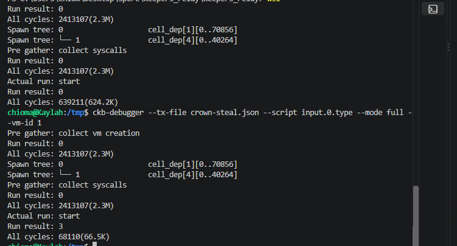

# Week 25

- Name: Chioma Christopher
- Week ending: 11-07-2026
- Project: Crowns
- Continues: [Week 24](../week_24/week_24.md)

---

## What happened

Last week I was still working through the feedback from Rick and from my mentor. This week it is all built, deployed on Pudge testnet, and tested with real wallets. I also replaced the old lane runner with a new game, Crown Run, changed the timing after a real game showed the old numbers were too tight, cleaned the testnet and the database so Crowns starts fresh, and added a second crown game, Crown Depths.

Where it stands now:

- Both pieces of feedback are live: anyone can close a crown, and a run is 5 laps revealed one block at a time, each with its own window.
- Crown Run replaces the old lane runner, which is gone.
- Crown Depths, a dungeon game, is deployed and hosts can pick it. It hasn't had a real two-wallet game yet.
- The new timing is live: a 3 minute lap window, a fixed 5 minute cut per steal, and a 10 minute clock floor.
- A full two-wallet crown played, closed and paid out on testnet, and every CKB came back except fees.

## The feedback, done

### Rick: late actions

The chain can't stop a late action, so the fix is to close fast. This is live:

- The close needs no signature. The script only lets the money go where the result says, so anyone can send it.
- Whoever closes gets 1 CKB from the host's share, never from the pot.
- Any open screen sends the close by itself when time is up.

### My mentor: bots

Any run the chain can check, a program can search for. What I can do is take away the head start. This is live:

- **Hidden road.** Lap 1's road comes from the block your entry lands in. You only see it after you have paid.
- **5 laps.** Each later lap's road comes from the block where the lap before was locked. A bot only ever sees one lap ahead.
- **A window per lap.** Each lap must be locked within 3 minutes of the block that revealed its road.
- **Proof of work on entry**, so mass entries cost something.
- **Key cells.** Laps are locked with a throwaway key in the browser, so there are no popups mid-run. The key cell goes back to the player when the game ends.

## New feedback this week: measuring the spawned game

On issue #45, luongthanhtung03 shared [ckb-cycle-tools](https://github.com/luongthanhtung03/ckb-cycle-tools), which reports cycles per script and diffs them across PRs. They asked whether a spawned script can be measured on its own. My mentor pointed to ckb-debugger's `--vm-id`. luongthanhtung03 then found that `--vm-id 1` fails in ckb-debugger 1.1.1: the replayed `inherited_fds` call doesn't write the count back, so the child sees 64 pipes instead of 1 and exits with 3. My mentor replied that they will fix it.

Crowns uses spawn on every steal. `match-type` holds the money rules and starts the game, `crown-run`, as a child. The child replays the laps and sends back the score. So I tried it on a real steal from my tests.

The tests only save a transaction when it fails, so I added a `DUMP_TX` setting that saves one even when it passes. Then:

```bash
ckb-debugger --tx-file crown-steal.json --script input.0.type --mode full --vm-id 0
ckb-debugger --tx-file crown-steal.json --script input.0.type --mode full --vm-id 1
```



- The spawn tree shows the two programs: vm 0 is `match-type` (70,856 bytes) and vm 1 is `crown-run` (40,264 bytes), started by it.
- The whole steal passes: result 0, about 2.41M cycles.
- vm 0 alone passes: 639,211 cycles. So the game replay is roughly 1.77M of the 2.41M.
- vm 1 alone fails with 3 after 68,110 cycles. That's the same bug. In the full runs above it, the same child passes.

Once the fix is out, `--vm-id 1` should show the game's own cycles directly.

## Crown Run

The lane runner was a first game. Crown Run replaces it completely, with no old code left in the scripts or the app.

- 5 laps of 30 seconds on three lanes, one try per lap.
- After laps 1 to 3 you pick an upgrade (Shield, Magnet, Overdrive, Fortune, Combo Master) and the next road. After lap 4 you pick only the road.
- **Safe** or **Danger** road. Danger has more blocks, moving blocks and more coins, and pays a bonus for finishing the lap.
- Score is distance plus coins plus finish bonuses, all added, so order never matters.
- Picks are written into the lap before it's locked, so they're fixed before the next road exists.

The rules are one Rust crate, `crown-run-core`, built for the chain and for the browser, so the score on screen is the score the chain gets.

## The timing, after a real game

On Nov 5 I played a real crown on testnet. A lap took 141 seconds to land, over the 2 minute window. Players couldn't finish runs. So the numbers changed:

| Rule | Before | Now |
|---|---|---|
| Time to lock a lap | 2 minutes | 3 minutes |
| A steal cuts the clock by | Half of what's left | A fixed 5 minutes |
| Clock floor | 7 minutes | 10 minutes |

A steal never takes the clock below 10 minutes after the stealer's last locked lap. At or under that, the clock stays and the pot still grows. The window and floor are set by the game, and the cut is in the shared code `match-type` uses.

## Testnet

- **Deployed** in transaction `0xb404cae16f09b3dbc93b1e6bbc34acb8577e5fb724ed29f570667f85748dd334`: `match-type` upgraded in place, so its type id stays the same, and the new `crown-run` game cell (data hash `0x90ea541e70b04a064b7de2fdc4a0b98fe1416e7d795504020620074174cf2c0c`).
- **A real two-wallet crown.** One player paid an entry, played and took the crown. The other was refunded in full at the close. The king was paid 1,466.99 CKB. Both key cells came back. The only CKB lost was about 0.03 in fees.
- **Starting over.** I spent the old code cells back to the deploy account in transaction `0x9974a2f6b4191b2b660a282ab5f6e74b1f2dec36b7b6b9b967f710702288fc27`, cleared the old crowns from the database, and put every deploy file in one folder.

## The app

- Paying an entry shows where it is: getting the entry ready, then approving in your wallet.
- The feed now shows when someone pays an entry.
- Duels have both paces again: Classic and Pressure.
- "Practice for free" sits next to "Host a crown", and Quick game is gone.

## Crown Depths

A second crown game, so players can choose what to play. It was also a test: can a new game join without touching the money scripts?

It could. `match-type`, `bid-type` and `treasury-lock` are unchanged. A crown names its game by the data hash of the game's script, so Crown Depths only needed its own game cell.

The game:

- 4 dungeon floors. Each floor is 3 by 3 rooms joined by doors, with slimes, bats and knights, gold, a key and a chest.
- Real time at 10 ticks a second. You walk with the arrows or the on-screen pad. Walking into a monster hits it.
- Each floor has a 60 second torch. Find the stairs before it goes out.
- After floors 1 to 3 you pick an item (Sword, Armor, Boots, Lantern, Gold Bag) and **safe** or **deep** stairs. Deep floors have more monsters and more gold, and pay a bonus for clearing them.
- The run ends when the torch goes out or you lose your hearts. Your points stay.

It plays by the same rules as Crown Run on chain: each floor's map comes from the block the floor before was locked in, each floor must be locked within 3 minutes, and picks are written into the floor before it's locked.

One more thing against bots: monsters only take their places when you first walk into their room, and where they stand depends on the moment you walk in. So a map can't be fully solved from its seed ahead of time.

I measured how much a bot gains, with test players on 60 runs each:

| Player | Average score | Runs ended early |
|---|---|---|
| New player (safe stairs, careful) | 2,506 | 0 of 60 |
| Good player (0.4 s reactions) | 3,562 | 18 of 60 |
| Bot (reacts every tick) | 4,277 | 1 of 60 |

A perfect bot is about 20% ahead of a good player. Most of the gap is strategy, not speed.

- **Deployed** in transaction `0x730f8e756b56a9c6e7dd2fda1b040ef0d7a0c6c86b8f081e1fc793913273ce7d`. Only the new game cell was added (data hash `0xc87e402276ab56a268999364842e8ba0c03aa3bbaf3203ecfc5fd58b2d76d4a3`); every other script is byte for byte the same as before.
- **Tests:** 175 pass. They cover opening a Crown Depths crown, refusing one with Crown Run's lap count, a steal that takes the crown, a steal that claims more than it scored, and a run copied from another player. A Crown Depths steal costs about 2.53M cycles.
- **Practice:** free on the practice page. A practice run is replayed the same way the chain does it, to check the score matches.
- **Not done yet:** a real two-wallet Crown Depths crown on testnet. That's first next week.

## What is next

Crowns' money scripts don't know which game they run. They spawn a game, it replays the moves, and it returns a score. Crown Run and artillery already work this way. Next I want to find out whether that holds up for games other people write.

- **How the scripts should talk to a game.** `spawn` (RFC 0050) looks like the only option, because `exec` (RFC 0034) never returns. Within spawn I want to compare three ways on the same run: what's live now (a hex argument and one pipe), raw bytes over two pipes, and my mentor's ckb-script-ipc library. I'll compare them on cycles and on code size, since code on chain costs CKB per byte.
- **Limits on the rules a game declares**, so a game can't make a crown unfair to its players.
- **A template** a builder can copy.

Alongside that, I'm playing a real two-wallet Crown Depths crown, and getting more people to play both games on testnet, so I can see if the rules hold up.
